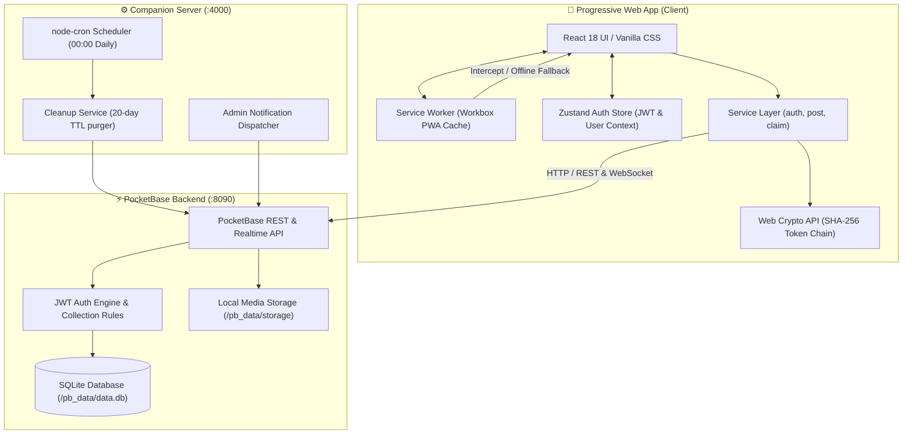
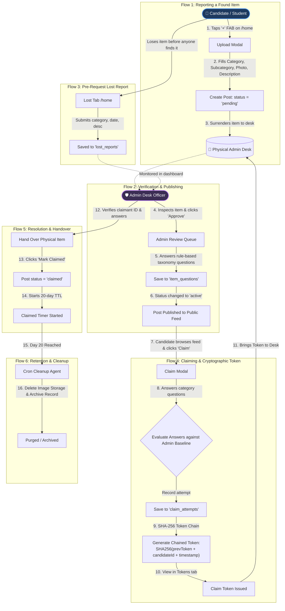
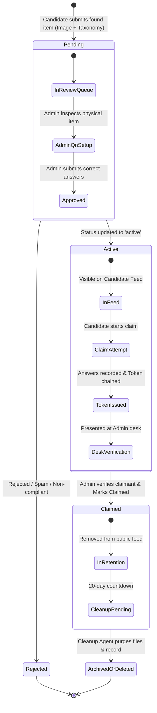
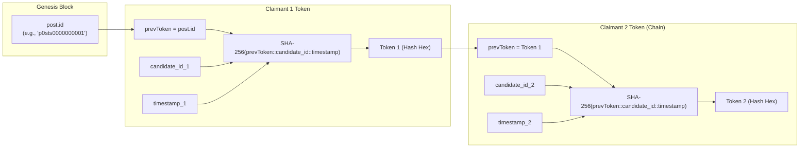
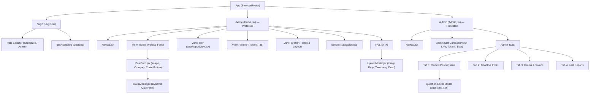
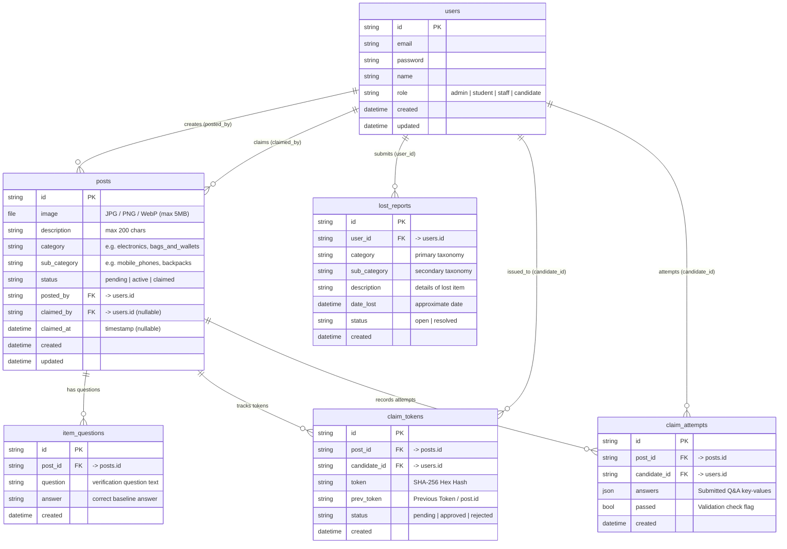

# 📦 IF-zero&one — Lost & Found PWA

> **A modern, privacy-focused Progressive Web App (PWA) for managing lost and found items in campuses and communities, backed by cryptographic claim verification and structured admin workflows.**

[](https://vitejs.dev/)
[](https://react.dev/)
[](https://pocketbase.io/)
[](https://web.dev/progressive-web-apps/)
[](https://nodejs.org/)
[](https://opensource.org/licenses/MIT)

---

## 📑 Table of Contents

- [Overview](#-overview)
- [System Architecture & Graph Maps](#-system-architecture--graph-maps)
  - [1. End-to-End System Topology Map](#1-end-to-end-system-topology-map)
  - [2. Comprehensive User & Data Flow Map](#2-comprehensive-user--data-flow-map)
  - [3. Post Lifecycle & State Transition Graph](#3-post-lifecycle--state-transition-graph)
  - [4. Cryptographic SHA-256 Token Chain Map](#4-cryptographic-sha-256-token-chain-map)
  - [5. Component Hierarchy & Navigation Map](#5-component-hierarchy--navigation-map)
  - [6. Entity Relationship (ER) Data Model](#6-entity-relationship-er-data-model)
- [Key Features](#-key-features)
- [Technology Stack](#-technology-stack)
- [Project Directory Structure](#-project-directory-structure)
- [Getting Started](#-getting-started)
  - [Prerequisites](#prerequisites)
  - [Installation & Setup](#installation--setup)
  - [PocketBase Backend Setup](#pocketbase-backend-setup)
  - [Running the Application](#running-the-application)
  - [Demo Accounts & Roles](#demo-accounts--roles)
- [Database Collections & API](#-database-collections--api)
- [Documentation Suite](#-documentation-suite)
- [License](#-license)

---

## 📌 Overview

**IF-zero&one** is an institutional Lost & Found system engineered for colleges, offices, and large campuses. It bridges the gap between individuals who find lost property and the genuine owners who seek to reclaim them, while preventing fraudulent claims through a **two-tier verification engine**:

1. **Found Item Submission & Triage:** Finders submit photo evidence, category taxonomy, and location descriptions. Items enter a `pending` state awaiting physical surrender to the admin desk.
2. **Physical Inspection & Rule-based Verification:** Administrators physically verify the item and record challenge answers (e.g., engravings, passcode hints, bag contents, phone case stickers).
3. **Claim Challenge & Cryptographic Token Generation:** Claimants answer category-specific verification questions. A deterministic **SHA-256 chained claim token** is generated linking the post, claimant identity, and timestamp.
4. **Desk Distribution & Audit Trail:** Physical handover is completed at the admin desk against the claim token, transitioning posts to `claimed` status, with an automated 20-day cleanup cycle.

---

## 🗺️ System Architecture & Graph Maps

### 1. End-to-End System Topology Map

The system combines a lightweight client-side PWA with an embedded PocketBase Go backend and an optional Node.js companion engine for background scheduling.



---

### 2. Comprehensive User & Data Flow Map

This graph outlines the exact journey of both **Candidates** (students/staff) and **Administrators** across every stage of the lost-and-found lifecycle.



---

### 3. Post Lifecycle & State Transition Graph



---

### 4. Cryptographic SHA-256 Token Chain Map

To guarantee auditability and prevent claim forgery or replay attacks, tokens are derived sequentially using a **cryptographic hash chain** computed via the browser's native `window.crypto.subtle`:



- **Genesis Seed:** The unique `post.id` acts as the genesis token for the first claim attempt.
- **Subsequent Nodes:** Each successive token hashes the previous claimant's token together with the new claimant's ID and exact millisecond timestamp (`${prevToken}::${candidateId}::${timestamp}`).
- **Integrity Guarantee:** The chain is immutable and deterministic. Admins can verify the sequential chain of claimants and detect any fabricated tokens.

---

### 5. Component Hierarchy & Navigation Map



---

### 6. Entity Relationship (ER) Data Model



---

## ✨ Key Features

- **📱 True Progressive Web App (PWA):**
  - Instant loading via Vite PWA Workbox caching.
  - Add to Home Screen (A2HS) support for iOS and Android.
  - Native feel with bottom navigation, snappy scroll feeds, and fluid micro-transitions.
- **🏷️ Deep Category Taxonomy (`questions.json`):**
  - Over 40+ specific sub-categories spanning Electronics, Wallets, IDs, Keys, Books, and Clothing.
  - Pre-calibrated verification questions tailored to each item type.
- **🛡️ Secure Verification Without Leaking Details:**
  - Challenge answers set by admins are never exposed directly to claimants.
  - Verification prevents social-engineering claims by asking specific, non-obvious details (e.g., lock screen background, key ring tag, internal compartment contents).
- **⛓️ Tamper-Evident SHA-256 Token Chain:**
  - Generates verifiable cryptographic proof of claim requests.
  - Uniquely binds the item, applicant, and time of claim into a single hexadecimal hash.
- **📋 Pre-Request Lost Reports:**
  - Candidates can register lost property proactively before it is turned in.
  - Admins can instantly match incoming found items with pending lost reports.
- **🎛️ Real-Time Admin Command Center:**
  - Quick-action stat cards showing items to review, active posts, pending tokens, and new lost reports.
  - One-click approvals, dynamic question prompting, and post closures.
- **🧹 Automated 20-Day Retention Cleanup:**
  - Background cron agent removes post media and cleans database records 20 days after claim fulfillment.

---

## 🛠️ Technology Stack

| Layer | Technologies |
|---|---|
| **Frontend Framework** | [React 18](https://react.dev/) + [Vite 5](https://vitejs.dev/) |
| **State Management** | [Zustand 4](https://github.com/pmndrs/zustand) |
| **Routing** | [React Router DOM v6](https://reactrouter.com/) |
| **Styling & Design** | Modern Vanilla CSS with Custom Design Tokens (`--bg-dark: #121212`, `--accent: #86efac`, Outfit font) |
| **Icons** | [Lucide React](https://lucide.dev/) |
| **Cryptography** | Native Web Crypto API (`SubtleCrypto.digest` SHA-256) |
| **Backend & Database** | [PocketBase 0.21+](https://pocketbase.io/) (SQLite + Go standalone binary) |
| **PWA Plugin** | `vite-plugin-pwa` (Workbox offline worker & web manifest) |
| **Companion / Cron** | [Express](https://expressjs.com/) + [node-cron](https://github.com/node-cron/node-cron) |

---

## 📁 Project Directory Structure

```
IF-zero&one/
├── docs/                             # Comprehensive Architecture & Workflow Docs
│   ├── AGENTS.md                     # Agent roles, permissions & capabilities
│   ├── ARCHITECTURE.md               # Technical architecture & collection specs
│   ├── FLOW.md                       # Detailed end-to-end user interaction flows
│   └── LOG.md                        # Architectural Decision Records (ADRs) & changelog
│
├── pocketbase/                       # PocketBase Backend Instance
│   ├── pb_migrations/                # Database schema migrations
│   │   ├── 1710000000_update_status.js
│   │   ├── 1710000001_add_categories.js
│   │   ├── 1710000002_create_lost_reports.js
│   │   ├── 1710000003_update_post_status.js
│   │   └── 1710000004_update_post_rules.js
│   ├── pb_data/                      # SQLite database files & uploaded images
│   ├── pb_schema.json                # Complete exported PocketBase schema
│   └── pocketbase                    # PocketBase binary executable
│
├── public/                           # Static assets & PWA manifest icons
│   ├── icon.svg
│   └── manifest.webmanifest
│
├── src/                              # Frontend Application Source
│   ├── components/                   # Modular UI Components
│   │   ├── ClaimModal.jsx            # Q&A claim challenge modal
│   │   ├── FAB.jsx                   # Floating Action Button for uploading
│   │   ├── LostReportView.jsx        # Pre-request lost report form
│   │   ├── Navbar.jsx                # Top bar with title and action triggers
│   │   ├── PostCard.jsx              # Feed post card with item photo & claim trigger
│   │   └── UploadModal.jsx           # Found item submission sheet
│   │
│   ├── pages/                        # Page-level Views
│   │   ├── Admin.jsx                 # Full admin management dashboard
│   │   ├── Home.jsx                  # Candidate portal (Feed, Lost, Tokens, Profile)
│   │   └── Login.jsx                 # Dual-role authentication portal
│   │
│   ├── services/                     # Decoupled API Service Layer
│   │   ├── auth.service.js           # JWT auth, user logins, session storage
│   │   ├── claim.service.js          # Q&A retrieval, attempt logger, token generation
│   │   ├── pb.js                     # PocketBase SDK singleton instance
│   │   └── post.service.js           # Post CRUD, image file handling, lost reports
│   │
│   ├── store/                        # Global State
│   │   └── authStore.js              # Zustand store for user session and auth state
│   │
│   ├── styles/                       # Modular Component & Global Styles
│   │   ├── Admin.css                 # Admin tables, stat cards, and modals
│   │   ├── ClaimModal.css            # Challenge modal styling
│   │   ├── FAB.css                   # Floating action button styles
│   │   ├── Home.css                  # Feed and bottom navigation styles
│   │   ├── Login.css                 # Login page styles
│   │   ├── Navbar.css                # Header styles
│   │   ├── PostCard.css              # Post card layout and overlays
│   │   ├── UploadModal.css           # Image picker and taxonomy selects
│   │   └── global.css                # Design tokens, color system, and resets
│   │
│   ├── utils/                        # Utility Libraries
│   │   ├── questions.json            # Deep hierarchical taxonomy & challenge questions
│   │   └── tokenChain.js             # SHA-256 native cryptographic chaining algorithm
│   │
│   ├── App.jsx                       # Route configuration & protected route guards
│   ├── main.jsx                      # React 18 DOM mount & PWA service worker registration
│   └── index.css                     # Base styling
│
├── .env.example                      # Environment variables template
├── git-sync.sh                       # Quick Git staging, commit, and push automation
├── index.html                        # Application entry point with font preloads
├── package.json                      # Node.js dependencies and script definitions
└── vite.config.js                    # Vite bundler, path aliases & PWA Workbox config
```

---

## 🚀 Getting Started

### Prerequisites

Ensure you have the following installed on your machine:
- **Node.js**: v18.0.0 or higher ([Download Node.js](https://nodejs.org/))
- **npm**: v9.0.0 or higher
- **PocketBase binary**: Included in the `pocketbase/` directory (or download from [PocketBase Releases](https://pocketbase.io/docs/))

---

### Installation & Setup

1. **Clone the repository:**
   ```bash
   git clone https://github.com/Venkatesh-107/IF-zero-one.git
   cd IF-zero-one
   ```

2. **Install frontend dependencies:**
   ```bash
   npm install
   ```

3. **Configure Environment Variables:**
   Create a `.env` file in the project root:
   ```bash
   cp .env.example .env
   ```
   Verify the contents of `.env`:
   ```ini
   # PocketBase server URL
   VITE_PB_URL=http://127.0.0.1:8090

   # Node.js Companion Server port
   NODE_PORT=4000

   # PocketBase Admin credentials (for background jobs)
   PB_ADMIN_EMAIL=admin@example.com
   PB_ADMIN_PASSWORD=your_admin_password

   # General Configuration
   VITE_APP_NAME="Lost & Found"
   VITE_CLAIM_EXPIRY_DAYS=20
   ```

---

### PocketBase Backend Setup

1. **Start the PocketBase server:**
   ```bash
   cd pocketbase
   ./pocketbase serve
   ```
   *(On Windows, run `pocketbase.exe serve`)*

2. **Access the Admin Dashboard:**
   - Open your browser at: `http://127.0.0.1:8090/_/`
   - On the first run, create your primary PocketBase Admin account.
   - The collections (`users`, `posts`, `item_questions`, `lost_reports`, `claim_tokens`, `claim_attempts`) are automatically migrated from `pb_migrations/` or can be imported via `pb_schema.json`.

---

### Running the Application

1. **Start the Vite Frontend Development Server:**
   ```bash
   npm run dev
   ```
   The application will be live at: `http://localhost:5173`

2. **(Optional) Run with Companion Server:**
   ```bash
   npm run dev:all
   ```

---

### Demo Accounts & Roles

The system supports role-based access control. You can register new accounts via the UI or use pre-configured test users:

| Role | Access URL | Permissions & Capabilities |
|---|---|---|
| **Admin** (`role: admin`) | `/admin` | Review queue, post approvals, set challenge answers, inspect tokens, mark claimed, manage reports |
| **Candidate** (`role: candidate` / `student`) | `/home` | Browse feed, report found items (`+`), file lost pre-reports, submit claim answers, receive claim tokens |

---

## 🗄️ Database Collections & API

The frontend interacts with PocketBase via standard REST endpoints and the official JS SDK (`src/services/`):

| Collection | Endpoint | Access Rules | Key Purpose |
|---|---|---|---|
| `users` | `/api/collections/users` | Auth Required | User profiles & role determination (`admin` vs `candidate`) |
| `posts` | `/api/collections/posts` | Public/Auth | Lost & found item listings, pictures, categories, and status |
| `item_questions` | `/api/collections/item_questions` | Auth (Admin update) | Baseline verification questions & answers per post |
| `lost_reports` | `/api/collections/lost_reports` | Auth Required | Pre-request lost reports submitted by users |
| `claim_tokens` | `/api/collections/claim_tokens` | Auth / Admin view | Cryptographic SHA-256 tokens issued to claimants |
| `claim_attempts` | `/api/collections/claim_attempts` | Auth / Admin view | Audit log of candidate responses and pass/fail evaluations |

---

## 📚 Documentation Suite

For deeper technical deep dives, refer to the documentation files in the [`docs/`](./docs) folder:

- 🏗️ **[docs/ARCHITECTURE.md](./docs/ARCHITECTURE.md)** — Architectural design, component breakdowns, data flow sequence diagrams, and database schemas.
- 🔄 **[docs/FLOW.md](./docs/FLOW.md)** — Detailed step-by-step user interaction scenarios, routing transitions, and verification logic.
- 🤖 **[docs/AGENTS.md](./docs/AGENTS.md)** — Human vs. automated agent definitions, responsibilities, and permissions matrix.
- 📋 **[docs/LOG.md](./docs/LOG.md)** — Architectural Decision Records (ADRs), milestone progress, and planned roadmap.

---

## 📄 License

This project is licensed under the [MIT License](./LICENSE) — see the LICENSE file for details.