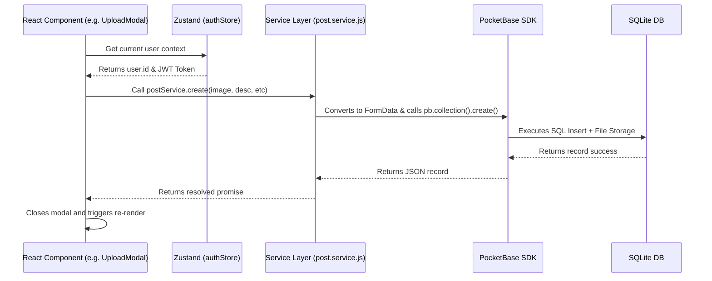

# 🏗️ ARCHITECTURE.md — Tech Stack & Components
> **Project:** Lost & Found PWA  
> **Stack:** Vite · React · Node.js · PocketBase · PWA  
> **Last Updated:** 2026-10-10

---

## 📌 Overview

This document describes the **technical architecture**, **technology stack**, and **UI component structure** of the Lost & Found application.

---

## 🛠️ Technology Stack

- **Frontend Core:** Vite + React + Vanilla CSS (No Tailwind)
- **Routing:** React Router DOM (v6)
- **State Management:** Zustand (for Auth Store and UI states)
- **Icons:** Lucide-React
- **Database & Backend:** PocketBase (SQLite + Go self-hosted backend)
- **Authentication:** PocketBase built-in JWT Auth
- **File Storage:** PocketBase local filesystem storage

---

## 🧩 Component Architecture

### Page Routes

- **`/` (Auth View):** The root route handles user authentication.
- **`/home` (Candidate Dashboard):** Protected route for standard users (students/staff). Contains the main feed and bottom navigation logic.
- **`/admin` (Admin Dashboard):** Protected route for administration.

### UI Components

```
App (Router)
 ├── <Login />
 │
 ├── <Home /> (Candidate Dashboard)
 │    ├── <Navbar />                 (Top Navigation)
 │    ├── <PostCard />               (Individual feed item with Image, Desc, Claim logic)
 │    ├── <LostReportView />         (Form for submitting a pre-request lost item)
 │    ├── <UploadModal />            (Bottom sheet for reporting a found item)
 │    ├── <ClaimModal />             (Q&A modal for verifying a claim)
 │    └── <FAB />                    (Floating Action Button for quick upload)
 │
 └── <Admin /> (Admin Dashboard)
      ├── <Navbar />
      └── Dashboard Tabs (Review posts, All posts, Claims & tokens, Lost reports)
```

---

## 🔌 Data Flow & Backend Communication

The application strictly adheres to a layered architecture to ensure components remain decoupled from the database API. 



### Communication Layers
1. **Presentation Layer (React Components):** Forms and views (`UploadModal`, `ClaimModal`, `Home`) handle user input and local state. They do NOT import `pocketbase` directly.
2. **Service Layer (`src/services/`):** Contains files like `post.service.js` and `claim.service.js`. These export methods that wrap the PocketBase SDK. This layer is responsible for data transformation (like building `FormData` for image uploads) and executing queries.
3. **Transport Layer (PocketBase SDK):** The `pb.js` singleton holds the active WebSocket/HTTP connection and automatically injects the user's JWT into the `Authorization` header of every REST API request.
4. **Backend (PocketBase Go Server):** Provides the auto-generated REST API. It validates the JWT against the collection's API rules (`@request.auth.id != ''`) before accepting the operation.
5. **Database (SQLite):** Stores the relational data locally on the server.

---

## 🗄️ Database Schema (PocketBase Collections)

### Collection: `users`
| Field       | Type     | Notes                          |
|-------------|----------|-------------------------------|
| `id`        | string   | Auto-generated PB ID           |
| `email`     | string   | Unique, required               |
| `password`  | string   | Hashed by PocketBase           |
| `role`      | select   | `admin` \| `candidate`        |
| `name`      | string   | Display name                   |

### Collection: `posts`
| Field         | Type     | Notes                                   |
| ------------- | -------- | --------------------------------------- |
| `id`          | string   | Auto-generated PB ID                    |
| `image`       | file     | Found item image (JPG/PNG/WEBP)         |
| `description` | text     | Short description (max 200 chars)       |
| `category`    | text     | Primary taxonomy (e.g. Electronics)     |
| `sub_category`| text     | Secondary taxonomy (e.g. Power Banks)   |
| `status`      | select   | `pending` \| `active` \| `claimed`      |
| `posted_by`   | relation | → `users.id`                            |

### Collection: `item_questions`
| Field      | Type     | Notes                          |
|------------|----------|-------------------------------|
| `post_id`  | relation | → `posts.id`                   |
| `question` | text     | The verification question      |
| `answer`   | text     | Correct answer set by admin    |

### Collection: `lost_reports` (Pre-Request Flow)
| Field         | Type     | Notes                                   |
| ------------- | -------- | --------------------------------------- |
| `user_id`     | relation | → `users.id`                            |
| `category`    | text     | Primary taxonomy                        |
| `sub_category`| text     | Secondary taxonomy                      |
| `description` | text     | Description of the lost item            |
| `date_lost`   | date     | Optional date the item was lost         |
| `status`      | select   | `open` \| `resolved`                    |

### Collection: `claim_attempts`
| Field          | Type     | Notes                            |
| -------------- | -------- | -------------------------------- |
| `post_id`      | relation | → `posts.id`                     |
| `candidate_id` | relation | → `users.id`                     |
| `answers`      | json     | Submitted Q&A pairs              |
| `passed`       | bool     | Passed internal validation       |

---

## 🔌 API & Service Layers

The frontend communicates with PocketBase via specialized service files located in `src/services/`:

- **`pb.js`**: Initializes the PocketBase SDK singleton.
- **`auth.service.js`**: Handles JWT exchange, user context, and logout.
- **`post.service.js`**: Handles CRUD operations for `posts` (including image FormData) and `lost_reports`.
- **`claim.service.js`**: Responsible for validating user answers against `item_questions` and logging `claim_attempts`.

### Underlying REST API (Auto-generated by PocketBase)

Even though we use the JS SDK in the Service Layer, underneath it makes standard HTTP requests to these endpoints:

| Method | Endpoint                            | Auth Required | Description                  |
|--------|-------------------------------------|---------------|------------------------------|
| POST   | `/api/collections/users/auth-with-password` | No  | Login (returns JWT + role)   |
| GET    | `/api/collections/posts/records`    | Yes         | Fetch paginated found itemsfeed |
| POST   | `/api/collections/posts/records`    | Yes         | Create new found item post   |
| PATCH  | `/api/collections/posts/records/:id`| Yes (admin)   | Update post status           |
| GET    | `/api/collections/item_questions/records?filter=(post_id='...')` | Yes | Fetch Q&A for a post |
| POST   | `/api/collections/lost_reports/records` | Yes | Submit a lost item report |
| POST   | `/api/collections/claim_attempts/records` | Yes | Submit claim answers |

---

## 🌐 PWA Configuration

| Property       | Value                            |
|----------------|----------------------------------|
| `name`         | Lost & Found Portal              |
| `short_name`   | L&F                              |
| `display`      | `standalone`                     |
| `theme_color`  | `#1c1c1c`                        |
| `start_url`    | `/`                              |
| `Service Worker` | Vite PWA plugin (Workbox)      |

---

## 📎 Related Documents
- [AGENTS.md](./AGENTS.md) — Agent roles and permissions
- [FLOW.md](./FLOW.md) — Step-by-step user interaction flows
- [LOG.md](./LOG.md) — Development changelog and decision log
;